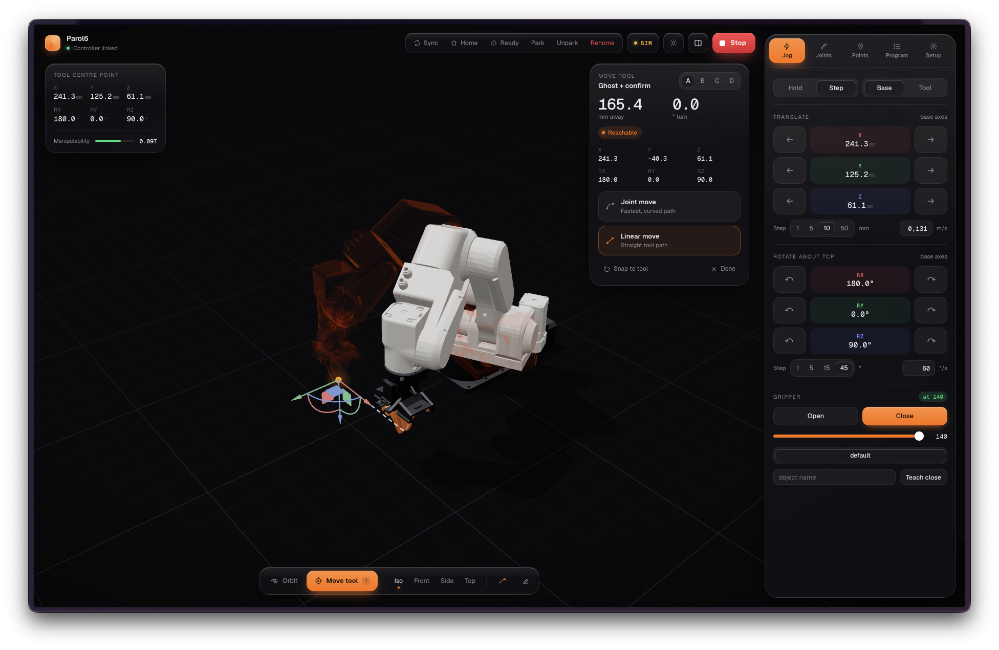
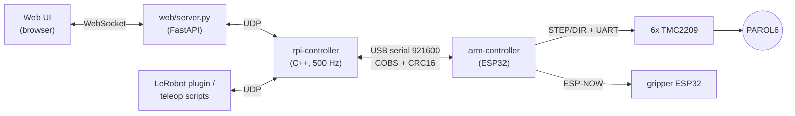

# Parol6 Control Stack

A custom control stack for the [PAROL6](https://source-robotics.github.io/PAROL-docs/) 6-axis desktop robot arm by Source Robotics. It replaces the stock controller with an ESP32 + TMC2209 drivers for the low level and a Raspberry Pi for everything smart: trajectory generation, inverse kinematics, a web UI and LeRobot integration.



*The web UI: 3D view of the arm with a ghost-move tool, Cartesian/joint jogging, saved points, programs, and gripper control.*

## Architecture



**The ESP32 is a deliberately dumb low-level controller.** It does no planning or kinematics. The Raspberry Pi streams a position and velocity command for every joint at 500 Hz, and the ESP32 turns that into step pulses with [FastAccelStepper](https://github.com/gin66/FastAccelStepper), time-stamping each move so the motors follow the commanded trajectory smoothly. It also handles homing, limit switches, TMC2209 setup over UART, motor power-loss detection, and lifetime odometry (stored in flash). It reports actual positions and status back in every reply.

**The Raspberry Pi is the brain, and it must run a real-time Linux kernel.** The 500 Hz loop has a hard 2 ms deadline: the ESP32 consumes a command every tick, so a late tick shows up as stutter or whining motors. The controller uses absolute-time sleeps and runs under `SCHED_FIFO` (`chrt -f 90`), which only gives reliable timing on a `PREEMPT_RT` kernel. The loop:

- generates jerk-limited trajectories with [Ruckig](https://github.com/pantor/ruckig),
- solves inverse kinematics and Jacobians with [Pinocchio](https://github.com/stack-of-tasks/pinocchio) (joint moves and straight-line Cartesian moves in base or tool frame),
- talks to the ESP32 over a CRC-protected COBS serial protocol ([protocol.h](rpi-controller/src/protocol.h), which must stay identical on both sides),
- exposes a UDP text command/telemetry interface and streams telemetry to [Foxglove](https://foxglove.dev/) / MCAP logs.

On top of that sit the web UI and a [LeRobot](https://github.com/huggingface/lerobot) robot plugin for teleoperation and policy training.

## Project Structure

- **[`mcu-code/`](mcu-code/)** - ESP32 firmware (PlatformIO):
  - **`arm-controller/`** - Low-level arm controller: step generation, homing, driver/power monitoring, odometer, serial protocol.
  - **`gripper-slave-sts3215/`**, **`gripper-slave-mg996r/`** - Gripper firmware (STS3215 bus servo / MG996R hobby servo), receiving commands from the arm controller over ESP-NOW.
- **[`rpi-controller/`](rpi-controller/)** - High-level controller that runs on the Raspberry Pi:
  - **`src/`** - C++ controller (`parolController`), kinematics, URDF/MuJoCo assets, and `mj_sim.py` (MuJoCo simulator fed by the controller telemetry).
  - **`web/`** - FastAPI server (`server.py`), saved poses/programs (`poses.json`) and the React + Three.js UI (`web/ui`).
- **[`lerobot/`](lerobot/)** - LeRobot robot plugin and scripts for recording, replaying and training on demonstrations.
- **[`misc_scripts/`](misc_scripts/)** - Teleop scripts (Leap Motion, phone, trackpad), MCAP/VCD analysis tools, and URDF/test utilities.
- **[`STLs/`](STLs/)** - CAD models, meshes and enclosures for the robot, gripper and add-ons.
- **[`calculations/`](calculations/)** - MATLAB scripts for kinematics verification.
- **[`docs/`](docs/)** - Images used in this README.

## Getting Started

**Firmware** (PlatformIO):

```bash
cd mcu-code/arm-controller
pio run -t upload
```

The firmware can also be simulated in Wokwi (see [wokwi.toml](wokwi.toml) and [diagram.json](diagram.json)).

**Controller** (on the Raspberry Pi, real-time kernel required, see [Architecture](#architecture)):

```bash
cd rpi-controller
cmake -B build
cmake --build build --parallel
sudo chrt -f 90 ./build/parolController /dev/ttyUSB1
```

**Web UI**:

```bash
cd rpi-controller/web
pip install -r requirements.txt
(cd ui && npm install && npm run build)   # React UI, served at /next
python3 server.py                         # http://<pi-ip>:8000
```
 

